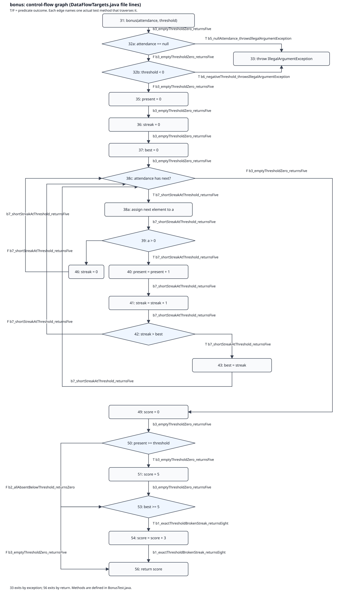

# Лаб 10: Өгөгдлийн урсгалын тест — Definition-Use хосууд

Бүх мөрийн дугаар нь `src/main/java/mn/edu/must/sqat/DataFlowTargets.java` **файлын** мөр
(лекцийн слайдын 1–8 дугаарлалт биш: 1→13, 3→15, 4→16, 5→17, 6→18, 8→20).

## A. gcd(x, y)

### A1. Def / use жагсаалт (файлын мөрөөр)

| Мөр | Код | Def | c-use | p-use |
|---|---|---|---|---|
| 13 | `gcd(int x, int y)` | x, y (параметр) | — | — |
| 14 | `int tmp;` | — (зөвхөн зарлал, утга оноогоогүй тул def биш) | — | — |
| 15 | `while (y != 0)` | — | — | y |
| 16 | `tmp = x % y;` | tmp | x, y | — |
| 17 | `x = y;` | x | y | — |
| 18 | `y = tmp;` | y | tmp | — |
| 20 | `return x;` | — | x | — |

### A2. DU хосуудын бүрэн хүснэгт

p-use-ийг `while`-ийн үнэн (T) ба худал (F) салаагаар тусад нь тоолсон тул нийт **13 мөр**
(def–use хосоор 11). Def-clear зам нь def-ээс use хүртэл тухайн хувьсагчийг дахин
тодорхойлохгүйгээр явах зам. `[T]`/`[F]` нь 15-р мөрийн салаа.

| № | Хувьсагч | Def мөр | Use мөр | c/p-use | Def-clear зам | Тестийн ID | Хамрагдсан |
|---|---|---|---|---|---|---|---|
| 1 | x | 13 | 16 | c | 13→15→16 | G2 | ✓ |
| 2 | x | 13 | 20 | c | 13→15→20 | G1 | ✓ |
| 3 | x | 17 | 16 | c | 17→18→15→16 | G2 | ✓ |
| 4 | x | 17 | 20 | c | 17→18→15→20 | G2 | ✓ |
| 5 | y | 13 | 15 | p (T) | 13→15→[T] | G2 | ✓ |
| 6 | y | 13 | 15 | p (F) | 13→15→[F] | G1 | ✓ |
| 7 | y | 13 | 16 | c | 13→15→16 | G2 | ✓ |
| 8 | y | 13 | 17 | c | 13→15→16→17 | G2 | ✓ |
| 9 | y | 18 | 15 | p (T) | 18→15→[T] | G2 | ✓ |
| 10 | y | 18 | 15 | p (F) | 18→15→[F] | G2 | ✓ |
| 11 | y | 18 | 16 | c | 18→15→16 | G2 | ✓ |
| 12 | y | 18 | 17 | c | 18→15→16→17 | G2 | ✓ |
| 13 | tmp | 16 | 18 | c | 16→17→18 | G2 | ✓ |

Kill-ээр тасрах хос байхгүй: `x`-ийн def 13 нь 16 болон 20-д, def 17 нь дараагийн давталтын 16
болон 20-д хүрдэг; `y`-ийн def бүр 15, 16, 17-д хүрдэг. Биелэшгүй хос байхгүй.

### A3. Тестүүд (`src/test/java/mn/edu/must/sqat/GcdTest.java`)

| ID | Дуудлага | Үр дүн | Хамарсан хос (№) |
|---|---|---|---|
| G1 `g1_loopSkipped_returnsFirstArgument` | `gcd(7, 0)` | 7 | 2, 6 |
| G2 `g2_twoIterations_returnsGcd` | `gcd(12, 8)` | 4 | 1, 3, 4, 5, 7, 8, 9, 10, 11, 12, 13 |

G1 ∪ G2 = 13/13 хос → **all-DU-pairs** хангагдсан. Тест бүрийн `@DisplayName`-д хамарсан
хосыг файлын мөрийн дугаараар бичсэн.

**`gcd(7, 0)` ямар хосыг ганцаараа хамардаг вэ?** Зөвхөн №2 (`x`: 13→20) ба №6 (`y`: 13→15 [F]).
Эдгээр нь давталтын биеийг огт гүйцэтгэхгүй замд л оршдог: `y == 0` байхад 13-аас шууд 15→20
рүү явна. Давталттай `gcd(12, 8)` тэднийг хамрахгүй.

**`gcd(12, 8)` хэдэн давталт хийдэг вэ?** 2 давталт: (x, y) = (12, 8) → (8, 4) → (4, 0), дараа нь
`y == 0` тул гарч 4-ийг буцаана. 15-р мөрийн нөхцөл 3 удаа шалгагдана (T, T, F).
**Хамгийн багадаа 2 давталт шаардах хосууд:** давталтын нэг давталтад тодорхойлсон утгыг
дараагийнх нь хэрэглэдэг хосууд — №3 (`x`: 17→16), №9 (`y`: 18→15 [T]), №11 (`y`: 18→16),
№12 (`y`: 18→17). Нэг давталт л хийдэг оролт (жишээ нь `gcd(6, 3)`) эдгээрийг хамрахгүй.

## B. bonus

### B2. Def / use жагсаалт

Параметрийн def нь 31-р мөр. 32-р мөрийн богино холболттой `||`-ийг `32a` =
`attendance == null`, `32b` = `threshold < 0` гэж салгав: `32a[T]` үед `32b`
шалгагдахгүй; JaCoCo энд дөрвөн салаа тоолно. 38-р мөрийн for-each-ийг `38c`
(дараагийн элемент байгаа эсэх, `attendance`-ийн p-use), `38a` (элементийг `a`-д
оноох def) гэж загварчлав. T/F нь тухайн нөхцөлийн үнэн/худал салаа.

| Мөр | Үйлдэл | Def | c-use | p-use |
|---|---|---|---|---|
| 31 | `bonus(attendance, threshold)` | attendance, threshold | — | — |
| 32a | `attendance == null` | — | — | attendance |
| 32b | `threshold < 0` | — | — | threshold |
| 33 | `throw new IllegalArgumentException(...)` | — | — | — |
| 35 | `present = 0` | present | — | — |
| 36 | `streak = 0` | streak | — | — |
| 37 | `best = 0` | best | — | — |
| 38c | Дараагийн элемент байна уу? | — | — | attendance |
| 38a | `a = дараагийн элемент` | a | — | — |
| 39 | `a > 0` | — | — | a |
| 40 | `present = present + 1` | present | present | — |
| 41 | `streak = streak + 1` | streak | streak | — |
| 42 | `streak > best` | — | — | streak, best |
| 43 | `best = streak` | best | streak | — |
| 46 | `streak = 0` | streak | — | — |
| 49 | `score = 0` | score | — | — |
| 50 | `present >= threshold` | — | — | present, threshold |
| 51 | `score = 5` | score | — | — |
| 53 | `best >= 5` | — | — | best |
| 54 | `score = score + 3` | score | score | — |
| 56 | `return score` | — | score | — |

34, 44–45, 47–48, 52, 55, 57-р мөрүүд нь хаалт/салааны зааг; шинэ def/use байхгүй.

### B3. DU хосууд ба kill

Хүснэгтэд p-use-ийн T/F салааг тусдаа мөрөөр тоолов: бүтцийн хувьд def-clear
замтай **35 мөрөөс 33 нь биелэх боломжтой**, 2 нь биелэшгүй. Замын `[T]`/`[F]`
нь эцсийн p-use-ийн салаа; дундах нөхцөлийн салааг дараагийн зангилаа тодорхойлно.
Өөртөө хүрэх `40→40`, `41→41` нь дараагийн давталтын use бөгөөд тухайн мөрийн
баруун талын use нь шинэ def-ээс өмнө хийгдэнэ.

| Хувьсагч | Def мөр | Use мөр | c/p-use | Def-clear зам | Тестийн ID | Хамрагдсан |
|---|---|---|---|---|---|---|
| a | 38a | 39 | p (F) | 38a→39→[F] | B1, B2, B7 | ✓ |
| a | 38a | 39 | p (T) | 38a→39→[T] | B1, B4, B7 | ✓ |
| attendance | 31 | 32a | p (F) | 31→32a→[F] | B1, B2, B3, B4, B6, B7 | ✓ |
| attendance | 31 | 32a | p (T) | 31→32a→[T] | B5 | ✓ |
| attendance | 31 | 38c | p (F) | 31→32a→32b→35→36→37→38c→[F] | B1, B2, B3, B4, B7 | ✓ |
| attendance | 31 | 38c | p (T) | 31→32a→32b→35→36→37→38c→[T] | B1, B2, B4, B7 | ✓ |
| best | 37 | 42 | p (F) | Бүтцийн зам: 37→38c→38a→39→40→41→42→[F] | — | Биелэшгүй (I1) |
| best | 37 | 42 | p (T) | 37→38c→38a→39→40→41→42→[T] | B1, B4, B7 | ✓ |
| best | 37 | 53 | p (F) | 37→38c→49→50→53→[F] | B2, B3 | ✓ |
| best | 37 | 53 | p (T) | Бүтцийн зам: 37→38c→49→50→53→[T] | — | Биелэшгүй (I2) |
| best | 43 | 42 | p (F) | 43→38c→38a→39→46→38c→38a→39→40→41→42→[F] | B1, B7 | ✓ |
| best | 43 | 42 | p (T) | 43→38c→38a→39→40→41→42→[T] | B1, B4, B7 | ✓ |
| best | 43 | 53 | p (F) | 43→38c→49→50→53→[F] | B7 | ✓ |
| best | 43 | 53 | p (T) | 43→38c→49→50→53→[T] | B1, B4 | ✓ |
| present | 35 | 40 | c | 35→36→37→38c→38a→39→40 | B1, B4, B7 | ✓ |
| present | 35 | 50 | p (F) | 35→36→37→38c→49→50→[F] | B2 | ✓ |
| present | 35 | 50 | p (T) | 35→36→37→38c→49→50→[T] | B3 | ✓ |
| present | 40 | 40 | c | 40→41→42→38c→38a→39→40 | B1, B4, B7 | ✓ |
| present | 40 | 50 | p (F) | 40→41→42→38c→49→50→[F] | B4 | ✓ |
| present | 40 | 50 | p (T) | 40→41→42→38c→49→50→[T] | B1, B7 | ✓ |
| score | 49 | 54 | c | 49→50→53→54 | B4 | ✓ |
| score | 49 | 56 | c | 49→50→53→56 | B2 | ✓ |
| score | 51 | 54 | c | 51→53→54 | B1 | ✓ |
| score | 51 | 56 | c | 51→53→56 | B3, B7 | ✓ |
| score | 54 | 56 | c | 54→56 | B1, B4 | ✓ |
| streak | 36 | 41 | c | 36→37→38c→38a→39→40→41 | B1, B4 | ✓ |
| streak | 41 | 41 | c | 41→42→38c→38a→39→40→41 | B1, B4, B7 | ✓ |
| streak | 41 | 42 | p (F) | 41→42→[F] | B1, B7 | ✓ |
| streak | 41 | 42 | p (T) | 41→42→[T] | B1, B4, B7 | ✓ |
| streak | 41 | 43 | c | 41→42→43 | B1, B4, B7 | ✓ |
| streak | 46 | 41 | c | 46→38c→38a→39→40→41 | B1, B7 | ✓ |
| threshold | 31 | 32b | p (F) | 31→32a→32b→[F] | B1, B2, B3, B4, B7 | ✓ |
| threshold | 31 | 32b | p (T) | 31→32a→32b→[T] | B6 | ✓ |
| threshold | 31 | 50 | p (F) | 31→32a→32b→35→36→37→38c→49→50→[F] | B2, B4 | ✓ |
| threshold | 31 | 50 | p (T) | 31→32a→32b→35→36→37→38c→49→50→[T] | B1, B3, B7 | ✓ |

**Биелэшгүй салааны үндэслэл:**

- **I1 — `best@37→42 p(F)`:** def 37 амьд байхад өмнө нь ирсэн өдөр байхгүй тул анхны ирсэн өдрийн `streak = 1 > best = 0` заавал үнэн бөгөөд def 43 үүснэ.
- **I2 — `best@37→53 p(T)`:** def 37 амьд үлдсэн бол `best` 0 хэвээр тул `best >= 5` үнэн болохгүй.

Эдгээрээс бусад хос бүрт тодорхой оролт олдсон. Эх кодтой тулгасан CFG ба утгын
урсгалын scratch загвараар урт 0–10 бүхий бүх 0/1 массив, threshold 0–(урт+1),
мөн null/сөрөг threshold гэсэн **22,530 гүйцэтгэлийг** бүрэн тоочиход 33 мөр
ажиглагдав; хоёр биелэшгүй мөрийн нотолгоо нь дээрх инвариант юм (тоочилт дангаараа
бүх уртын боломжгүйг нотлохгүй). 0/1 нь тасалсан/ирсэн хоёр салааны төлөөлөл.

**46-р мөрийн kill:** `streak = 0` нь тухайн үед амьд байгаа def 36 (анхны
таслалт), def 41 (ирсний дараах таслалт), эсвэл өмнөх давталтын def 46 (дараалсан
таслалт)-г ална. Тиймээс def 36/41-ээс 46-г дайрч 41-д хүрэх зам def-clear биш;
шинэ def 46 л дараагийн 41-ийн c-use-д хүрнэ. Def 41 нь өмнөх 36/41/46-г,
40 нь өмнөх present@35/40-г, 43 нь best@37/43-г, 51 нь score@49-г,
54 нь score@49/51-г, 38a нь өмнөх a@38a-г дахин тодорхойлно.

**Kill-ээр бүх зам нь тасрах хослолууд (DU хос биш):**

| Хувьсагч | Def мөр | Use мөр | Таслах def / үндэслэл |
|---|---|---|---|
| streak | 36 | 42 p(T/F) | 42-д хүрэхийн өмнө 41 заавал шинэчилнэ. |
| streak | 36 | 43 c | 43-д хүрэхийн өмнө 41 заавал шинэчилнэ. |
| streak | 46 | 42 p(T/F) | Дараагийн ирсэн өдөр 41 заавал шинэчилнэ. |
| streak | 46 | 43 c | Дараагийн ирсэн өдөр 41 заавал шинэчилнэ. |

Жишээлбэл `score@49→56` нь 51-ийг дайрвал тасарна, харин 50[F]→53[F]
гэсэн def-clear өөр замтай учир бүхэлд нь хасахгүй; дээрх хүснэгтэд DU хосоор үлдэнэ.

### B4. Тестийн хоёр шат

#### 1. Хамгийн цөөн all-defs тест

**Хоёр тест хангалттай бөгөөд нэгээр боломжгүй.** Нэг дуудлагаар 49 ба 51-ийн
хоёр score def-ийг хоёуланг use-д хүргэж чадахгүй: 50[T] үед 51 нь 49-ийг
ямар ч score use-ээс өмнө ална, 50[F] үед 51 огт гүйцэтгэгдэхгүй. B1 нь
`score@51→54` болон `score@54→56`-г, B2 нь `score@49→56`-г хамарна; бусад
бүх def-ээс дор хаяж нэг use-д хүрэх зам B1/B2 дотор байна. B1-д эхний
таван ирсэн өдөр def 36/41, завсрын таслалтын дараах ирэлт def 46-г 41-д
хүргэнэ; def 37 нь эхний 42-д, def 43 нь дараагийн 42/53-д хүрнэ.

| ID / бодит метод | Оролт (attendance; threshold) | Javadoc-аас хүлээх утга |
|---|---|---|
| B1 `b1_exactThresholdBrokenStreak_returnsEight` | `[1, 1, 1, 1, 1, 0, 1, 1]; 7` | 8 |
| B2 `b2_allAbsentBelowThreshold_returnsZero` | `[0, 0]; 1` | 0 |

Хүлээх утгыг Javadoc-ийн дүрмээс тооцов: B1-д ирсэн 7 өдөр нь threshold 7-д
хүрч 5 оноо, хамгийн урт 5 өдрийн цуваа нэмж 3; B2-д ирсэн 0 өдөр нь
threshold 1-д хүрэхгүй, урт цуваагүй тул 0.

All-defs шатны нотолгоо: [`mvn-verify-alldefs.txt`](results/mvn-verify-alldefs.txt),
[`jacoco-alldefs.csv`](results/jacoco-alldefs.csv). **Tests run: 4** (gcd 2 + bonus 2),
алдаа 0. Классын **BRANCH_MISSED = 2, BRANCH_COVERED = 14 (14/16 = 87.5%)**,
**LINE_MISSED = 2, LINE_COVERED = 22**: далд constructor (7) ба алдаа шидэх (33) мөр.
All-defs хангагдсан ч 32-р мөрийн хоёр алдааны салаа шалгагдаагүй учир branch 100% биш.

#### 2. All-DU-pairs болгон өргөтгөсөн нь

| ID / бодит метод | Оролт (attendance; threshold) | Javadoc-аас хүлээх утга |
|---|---|---|
| B3 `b3_emptyThresholdZero_returnsFive` | `[]; 0` | 5 |
| B4 `b4_sixDayStreakBelowThreshold_returnsThree` | `[1, 1, 1, 1, 1, 1]; 7` | 3 |
| B5 `b5_nullAttendance_throwsIllegalArgumentException` | `null; 0` | `IllegalArgumentException` |
| B6 `b6_negativeThreshold_throwsIllegalArgumentException` | `[]; -1` | `IllegalArgumentException` |
| B7 `b7_shortStreakAtThreshold_returnsFive` | `[0, 1, 1, 0, 1]; 3` | 5 |

B3 нь хоосон массив ба threshold=0 (`0 >= 0` тул 5); B4 нь 6 өдрийн цуваатай
боловч threshold 7-д хүрэхгүй тул зөвхөн нэмэлт 3 оноо; B5/B6 нь Javadoc-ийн
хоёр буруу оролт; B7 нь нийт 3 ирсэн өдөр threshold 3-д хүрч 5 оноо авна,
харин хамгийн урт цуваа 2 тул нэмэлт оноогүй. Хүснэгтэд **33/33 биелэх боломжтой
DU мөр** хамрагдсан, I1/I2-г хамрах шаардлагагүй.

`mvn -B verify` амжилттай: **Tests run: 9** (gcd 2 + bonus 7), алдаа 0.
`target/site/jacoco/jacoco.csv`-ийн all-DU үеийн утга: **BRANCH_MISSED = 0,
BRANCH_COVERED = 16 (100%)**, **LINE_MISSED = 1, LINE_COVERED = 23**.
Хамрагдаагүй 7-р мөр нь Java-гийн далд constructor тул түүнд зориулж тест нэмээгүй.

**Branch ба DU ялгаатай:** B1+B2+B5+B6 (мөн gcd-ийн G1/G2) нь аль хэдийн
16/16 салааг дайрна, гэвч `present@35→50 p(T)` хос хамрагдахгүй: 50[T]-г B1
дайрахдаа present-ийг 40-д шинэчилсэн байдаг, харин def 35-ыг хадгалсан B2 зөвхөн
50[F]-г дайрна. B3-ийн хоосон массив, threshold=0 нь def 35-ыг хэвээр хадгалж
50[T]-д хүргэн энэ DU хосыг нөхнө. Иймээс branch 100% болсон ч DU дутуу байж болно.

### B1. Удирдлагын урсгалын граф

Зурагт ирмэг бүрийн хажууд түүнийг дайрдаг дор хаяж нэг бодит тестийн метод
бичсэн; T/F нь нөхцөлийн салаа. Энгийн зангилаанд файлын мөрийн дугаар,
32/38-ын салгасан зангилаанд дээрх 32a/32b, 38c/38a тэмдэглэгээг хэрэглэв.
