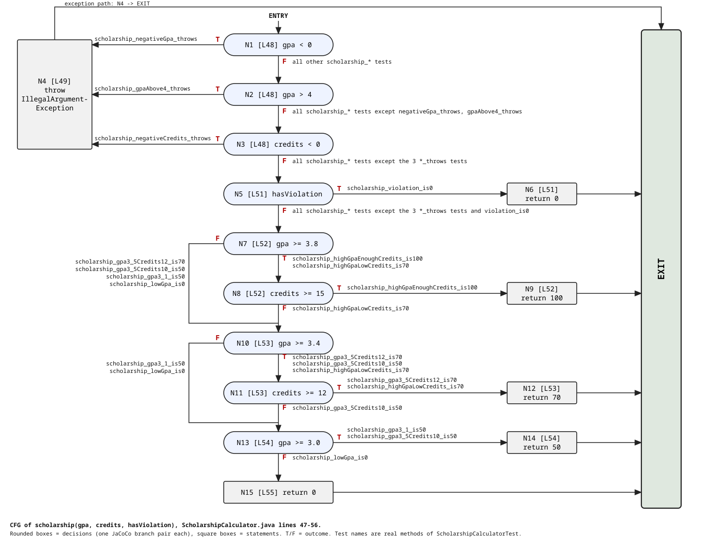

# Лаб 9: Код хамралт — JaCoCo (ScholarshipCalculator)

- Нэр: Г. Үлэмж
- Оюутны код: B232270805
- Хичээл: F.CSA313 — Программ хангамжийн чанарын баталгаа ба тест (2026)

## Орчин

`results/` доторх бүх файлыг үүсгэсэн машин дээрх хоёр командын бүтэн гаралт:

```
$ java -version
openjdk version "25.0.4" 2026-07-21
OpenJDK Runtime Environment (build 25.0.4+-16339643-b508.27)
OpenJDK 64-Bit Server VM (build 25.0.4+-16339643-b508.27, mixed mode)

$ mvn -version
Apache Maven 3.9.9 (8e8579a9e76f7d015ee5ec7bfcdc97d260186937)
Maven home: /tmp/apache-maven-3.9.9
Java version: 25.0.4, vendor: JetBrains s.r.o., runtime: /opt/android-studio/jbr
Default locale: en_US, platform encoding: UTF-8
OS name: "linux", version: "7.2.14-arch1-1", arch: "amd64", family: "unix"
```

Тэмдэглэл: JDK нь 17 биш 25 хувилбар. `pom.xml`-ийг өөрчлөөгүй: `maven.compiler.release=17` тохиргоогоор compile хийгддэг бөгөөд JaCoCo 0.8.12 энэ JDK дээр хэвийн ажилласан. Maven 3.9.9-ийг системд суулгаагүй, tar архиваас задалж ашигласан.

Бүгдийг `mvn verify` командаар ажиллуулна. JaCoCo тайлан `target/site/jacoco/` хавтсанд (HTML, XML, CSV) үүснэ.

## Хэсэг A: Happy path тест ба эхний хэмжилт

5 хэвийн урсгалын тест: `letterGrade_95_isA`, `letterGrade_85_isB`, `gpa_95and85_is3_5`, `scholarship_highGpaEnoughCredits_is100`, `scholarship_gpa3_1_is50`.

`results/jacoco-A.csv`-ээс:

| Үзүүлэлт | Хамрагдаагүй | Хамрагдсан | Хамралт |
|---|---|---|---|
| Line | 9 | 16 | 16/25 = 64% |
| Branch | 21 | 20 | 20/41 = 48.8% |

JaCoCo тайлан дээрх ажиглалт (`ScholarshipCalculator.java`, мөрийн дугаар нь эх кодынх):

- Улаан (огт ажиллаагүй) мөрүүд: гурван `throw new IllegalArgumentException` (21, 32, 49-р мөр), `letterGrade`-ийн C/D/F-д хүрэх мөрүүд (25-27), `gpa`-ийн `switch`-ийн `case "C"` ба `case "D"` (39, 40) ба `scholarship`-ийн сүүлийн `return 0` (55). `default` (F) салаа өөрийн мөргүй тул зөвхөн 36-р мөрийн дутуу салаа болж харагдана. Өөрөөр хэлбэл алдааны бүх зам, A/B-ээс бусад үсгэн дүн тестлэгдээгүй байна.
- Шар (салаа хагас хамрагдсан) мөрүүд: `letterGrade`-ийн хүрээний шалгалт (20) ба `>= 80` (24), `gpa`-ийн null/хоосон шалгалт (31), `switch (letterGrade(s))` (36; 5 салааны 3 нь хамрагдаагүй: C, D ба default (F)), `scholarship`-ийн оролтын шалгалт (48) болон `hasViolation`, `>= 3.8 && >= 15`, `>= 3.4 && >= 12`, `>= 3.0` нөхцөлүүд (51-54). Эдгээрт үнэн эсвэл худал талын аль нэг нь хэзээ ч биелээгүй (жишээ нь `&&`, `||`-ийн хоёр дахь нөхцөл шалгагдаагүй).

## Хэсэг B: CFG зурж branch 100% хүрэх

`cfg.png` (эх файл нь `cfg.svg`) нь `scholarship()` функцын CFG. N1-N15 зангилаа нь эх кодын мөртэй таарна, ирмэг бүрийн хажууд түүнийг дайрах тестийн бодит нэр бичигдсэн. `gpa < 0 || gpa > 4 || credits < 0` нөхцөл бүрийг JaCoCo тусдаа салаа гэж тоолдог тул тус тусын зангилаа (N1-N3) болгосон. CFG-г цахим хэлбэрээр зурсан (гараар биш).



Гурван функцэд нэмсэн тестүүд:

- `letterGrade`: `letterGrade_75_isC`, `letterGrade_65_isD`, `letterGrade_30_isF`, `letterGrade_negative_throws`, `letterGrade_above100_throws`
- `gpa`: `gpa_null_throws`, `gpa_empty_throws`, `gpa_allGradeKinds_is2_0` (A, B, C, D, F бүгд нэг дуудлагад, тиймээс `switch`-ийн салаа бүр ажиллана)
- `scholarship`: `scholarship_negativeGpa_throws`, `scholarship_gpaAbove4_throws`, `scholarship_negativeCredits_throws` (`||`-ийн нөхцөл бүрт нэг `assertThrows`), `scholarship_violation_is0`, `scholarship_highGpaLowCredits_is70`, `scholarship_gpa3_5Credits12_is70`, `scholarship_gpa3_5Credits10_is50`, `scholarship_lowGpa_is0`

Нийт шаардагдсан тест: **21** (`results/mvn-verify-B.txt`-д `Tests run: 21`).
`results/jacoco-B.csv`: `BRANCH_MISSED = 0` (41/41 хамрагдсан), `LINE_MISSED = 0` (25/25 хамрагдсан).

## Хэсэг C: Давталтын заагийн тестүүд

`gpa()` доторх давталтад 0 / 1 / 2+ дүрмийг хэрэгжүүлсэн:

| Давталтын тоо | Тест |
|---|---|
| 0 | `gpa_empty_throws` ба `gpa_null_throws` (Хэсэг B-д нэмсэн; давталтын бие огт ажиллахгүй) |
| 1 | `gpa_oneScore_is4_0`: `gpa([95]) == 4.0` |
| 2+ | `gpa_manyScores_is2_5`: `gpa([95, 85, 75, 65]) == 2.5` |

Хэсэг C-ийн дараа: 23 тест, хамрагдаагүй салаа/мөр 0 хэвээр (`results/mvn-verify-C.txt`, `results/jacoco-C.csv`).

Эдгээр тест хамралтын тоог өсгөхгүй, учир нь давталт аль хэдийн 100% хамрагдсан. Гэхдээ хамралт нь мөр, салаа ядаж нэг удаа ажилласныг л хэлдэг тул давталт 0, 1, олон элементтэй үед зөв ажиллаж буйг (жишээ нь `scores.length`-д хуваах, нэгээр алдах, голч буруу бодогдох) зөвхөн ийм тест баталгаажуулна.

## Хэсэг D: Хамралт 100% — гэхдээ алдаа амьд

Спецификацаас гаргасан зааг утгын тестүүд нэмсэн: `letterGrade_60_isD` ба `letterGrade_boundaries` (параметртэй: 0, 59.99, 60, 69.99, 70, 79.99, 80, 89.99, 90, 100).

Засахаас өмнөх кодоор `mvn test` ажиллуулахад (`results/mvn-test-D-fail.txt`) `Tests run: 34, Failures: 2` гарсан. Унасан тестүүд:

```
ScholarshipCalculatorTest.letterGrade_60_isD:148 expected: <D> but was: <F>
ScholarshipCalculatorTest.letterGrade_boundaries:165 expected: <D> but was: <F>
```

(`letterGrade_boundaries(double, String)[3]` нь `60, D` мөр.)

Алдаа: `letterGrade` функц `if (score > 60) return "D";` гэж бичигдсэн байсан боловч спецификаци 60-69.99-ийг "D" гэж заасан. Иймээс 60 оноо "F" болж буцаж байв. Засвар: `score >= 60`. Засварын commit: `2af857b` — `Fix letterGrade: > 60 -> >= 60, spec says 60 is D (letterGrade(60) returned F)`. Засвараас хойш (`results/mvn-verify-final.txt`): `Tests run: 34, Failures: 0`, мөн `results/jacoco-final.csv`-д `BRANCH_MISSED = 0`, `LINE_MISSED = 0`.

### Дүгнэлт

`score > 60` ба `score >= 60` хоёул яг ижил хоёр салаа (үнэн ба худал) үүсгэдэг тул 65 (үнэн) ба 30 (худал) гэсэн тестүүд хоёр салааг хоёуланг нь хамарч, Хэсэг B-д branch хамралт 100% болсон ч алдаа үл үзэгдэн үлдсэн. Зөвхөн заагийн утга 60-ыг шалгасан тест л хоёр операторын ялгааг илрүүлнэ. Хамралт нь кодын аль хэсэг ажилласныг хэмждэг. Харин ажилласан код зөв үр дүн өгсөн эсэх, зөв оролтын утга сонгосон эсэх, спецификацийн шаардлага орхигдсон эсэх, assert дутуу эсэхийг хэмждэггүй. Иймээс 100% хамралт нь тестлэгдээгүй кодыг олоход зайлшгүй хэрэгтэй боловч код зөв гэдгийн хангалттай нотолгоо биш бөгөөд спецификацаас гаргасан заагийн утгын тестүүдтэй хамт хэрэглэх ёстой.
